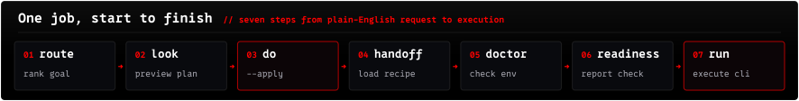

# Agent skills that work in plain English and show the plan before anything installs

[](https://github.com/avalonreset/cto-legends/releases/tag/v0.2.11) [](https://pypi.org/project/cto-legends/) [](https://github.com/avalonreset/cto-legends/actions/workflows/checks.yml) [](LICENSE)

Most **agent skills** setups pile up one folder per tool before you can ask an ordinary question. With `cto-legends`, you register one lightweight router skill and talk to your coding agent in plain English: ask it to *"study my business on Google Maps"*, *"convert my WordPress site to Astro v7"*, *"save this research in my vault"*, or *"Can we generate some AI music?"* One router reaches 21 independent CLI modules on demand, reads a module's recipe only when the job calls for it, and prints a JSON plan before `--apply` changes anything on disk.

Type `cto-legends install legends-geogrid` and nothing gets installed. You get the plan. Add `--apply` after you have read it.

**`>_ agent handoff`** (copy and paste into Claude Code, Codex, Gemini CLI, or OpenCode)

```text
Install cto-legends from PyPI with python -m pip install cto-legends, then run
cto-legends agent-setup for this host without --apply and show me the JSON plan
before changing anything. Once I approve, register the single cto-legends skill
so we can route and preview any of the 21 Legends modules on demand.
```

**`>_ terminal quick start`** (Python 3.11+; `pip` installs the router, nothing else mutates disk without `--apply`)

```sh
python -m pip install cto-legends                # PyPI v0.2.11 (CLI alias: ctolegends)
cto-legends agent-setup claude                   # 1. look: prints JSON plan, changes nothing
cto-legends agent-setup claude --apply           # 2. do: writes ~/.claude/skills/cto-legends
cto-legends route "study my business on Google Maps"
cto-legends install legends-geogrid              # 1. look: previews v0.2.7 + transport plan
cto-legends install legends-geogrid --apply      # 2. do: verifies SHA-256 and builds isolated venv
```

Installation previews run offline, and `--apply` verifies pinned GitHub release archives without collecting credentials or triggering paid API calls. If you think **agent skills** should show the plan before touching your machine, [star this repository on GitHub](https://github.com/avalonreset/cto-legends) so the next developer can find it.

## Talk in plain words, see the match before anything runs

Months of daily building with coding agents teach a clear lesson: the most productive sessions never start with you hunting through documentation for CLI flags, environment variables, or repository names. They start when you tell your agent the job in your own words, the way you would brief a sharp technical partner across the desk.

Sitting down with a coding agent feels natural when you can describe the outcome in plain English instead of memorizing module names and flag syntax. Hand a request to `cto-legends route` and the router scores your phrasing against the local catalog, returns ranked candidate modules with matched signals, and gives your agent the exact `handoff` command to load that module's recipe.

| What you say to your coding agent | Top `route` match | Why the router picks it | What happens next |
| :--- | :--- | :--- | :--- |
| `"study my business on Google Maps"` | [`legends-geogrid`](https://github.com/avalonreset/legends-geogrid) (`0.2.7`) | Matches `google maps` ranking grids, circular-lattice studies, and 21-page strategy reports | Previews install (with `legends-dataforseo` transport), checks local deps via `report-readiness`, and loads the recipe via `handoff` |
| `"convert my WordPress site to Astro v7"` | [`legends-astro`](https://github.com/avalonreset/legends-astro) (`0.2.4`) | Matches `astro` and `astro v7` site migrations, `source-audit` contract extraction, and build parity checks | Previews install, pairs with `legends-firecrawl` scrape exports when needed, and reads the migration workflow via `handoff legends-astro` |
| `"save this research in my vault"` | [`legends-empire`](https://github.com/avalonreset/legends-empire) (`0.4.0`) | Matches `vault` Markdown memory, source-cited notes, and `legends-vault-stewardship` workflows | Previews install and loads intake contracts without creating or altering any vault until you explicitly select one |
| `"Can we generate some AI music?"` | [`legends-stable-audio-3`](https://github.com/avalonreset/legends-stable-audio-3) (`0.1.5`) | Matches `ai music` instrumental beds, sound effects, and crossfaded mixes | Routes to the planning CLI, then warns to verify GPU VRAM, Hugging Face model access, and weights before promising generation |

## Look, then do: why preview is the default

Traditional README quick starts assumed a human read each shell command before pasting it into a terminal. Today, your coding agent is usually the one typing install and configuration commands on your behalf, so mutating your filesystem on the first keystroke means finding out what changed after the fact.


Every state-changing command across the CLI (`install`, `update`, `rollback`, `sync`, `agent-setup`, `install-skill`, `isolate-skills`, `restore-skills`, `startup-setup`, `startup-restore`, and `register-guide`) returns a deterministic JSON preview whenever `--apply` is omitted. Here is the real preview output of `cto-legends install legends-geogrid` at `v0.2.11`:

```json
{
  "preview": true,
  "changes": [
    {
      "id": "legends-geogrid",
      "version": "0.2.7",
      "action": "install",
      "commit": "a3055838ab4129abbcac66d3ce2b17c7a43e1bec",
      "dependencies": {
        "legends-dataforseo": "0.1.11"
      },
      "scope": "Self-contained static HTML competitive map companion (study.py --open), circular-lattice sampling, business-name review workbench..."
    }
  ]
}
```

Adding `--apply` fetches the pinned release archive from GitHub, verifies its commit SHA and SHA-256 digest against the active catalog, builds an isolated Python virtual environment under `~/.cto-legends/releases/`, and retains your prior version on disk for instant rollback. Router previews inspect local catalog metadata and target paths only; they do not test external provider APIs or estimate what a third-party service will bill during downstream runs.

Across the 22 repositories in this family (`cto-legends` and its 21 modules), operational and cost guardrails are documented per repository rather than assumed globally:

* **12 of 22 repositories document a preview or dry run before changing state:** `cto-legends`, `legends-ambient-intelligence`, `legends-astro`, `legends-buzz`, `legends-cloudflare`, `legends-empire`, `legends-github`, `legends-gohighlevel`, `legends-hetzner`, `legends-obs`, `legends-stripe`, and `legends-yt-dlp`.
* **5 of 22 repositories document a spend ceiling, quota plan, or cost check before a paid call:** `legends-dataforseo`, `legends-geogrid`, `legends-github`, `legends-stable-audio-3`, and `legends-youtube`.

## One router instead of a growing shelf of agent skills

Open your coding agent's skills directory after a few months of heavy work and count the folders inside. Every folder was added for one specific afternoon: a search wrapper from Tuesday, a deployment helper from last month, a vault script from a weekend experiment. All of them stay registered on the days you are working on something completely different.


Registering `cto-legends` replaces per-module skill folders with one compact router ([`cto_legends/SKILL.md`](cto_legends/SKILL.md)) and loads a module's operating instructions via `handoff` only when a task actually calls for them. Earlier releases of this ecosystem shipped 31 separate standalone skill folders before consolidating all of them behind the single router.

<details>
<summary>See all 31 retired standalone skill folders replaced by <code>cto-legends</code></summary>

* **6 catalog-level duplicates:** `cto-legends-library`, `legends-geogrid`, `legends-dataforseo`, `legends-dataforseo-kit`, `legends-github`, `legends-empire`
* **15 vault and wiki skills folded into `legends-empire`:** `autoresearch`, `canvas`, `defuddle`, `obsidian-bases`, `obsidian-markdown`, `save`, `think`, `wiki`, `wiki-cli`, `wiki-fold`, `wiki-ingest`, `wiki-lint`, `wiki-mode`, `wiki-query`, `wiki-retrieve`
* **10 repository workflow skills folded into `legends-github`:** `github`, `github-audit`, `github-community`, `github-dataforseo`, `github-empire`, `github-legal`, `github-meta`, `github-readme`, `github-release`, `github-seo`

</details>

Migrating away from older per-module skill folders follows the same reversible look-then-do pattern:

```sh
cto-legends agent-audit claude                   # read-only inventory of overlapping skill folders
cto-legends isolate-skills claude                # 1. look: preview move plan and backup path
cto-legends isolate-skills claude --apply        # 2. do: move retired skills into ~/.cto-legends-skill-backups/<uuid>/
cto-legends restore-skills <manifest> --apply    # restore isolated folders from the backup manifest
```

Nothing is deleted during isolation because each relocated folder is tracked inside a `manifest.json` receipt for one-command restoration. Because `agent-audit` inspects filesystem directories only, host plugins, cached snapshots, and injected catalogs remain untouched until you confirm discovery in a fresh agent session.

## One job start to finish: seven steps from plain words to output

Say *"study my business on Google Maps"* in normal conversation and watch what happens underneath. Whether your coding agent drives the session or you type every command yourself in a shell, the request moves through seven small, inspectable stages without hidden magic.



```sh
cto-legends route "study my business on Google Maps"   # 01 route: ranked candidates + matched signals
cto-legends install legends-geogrid                    # 02 look: offline JSON install plan
cto-legends install legends-geogrid --apply            # 03 do: SHA-256 check + isolated venv
cto-legends handoff legends-geogrid                    # 04 handoff: resolve this module's recipe paths
cto-legends doctor                                     # 05 doctor: verify managed CLI health
cto-legends report-readiness                           # 06 readiness: check GeoGrid map/report/transport deps
cto-legends run legends-geogrid -- --help              # 07 run: execute inside your current working directory
```

Notice how installing [`legends-geogrid`](https://github.com/avalonreset/legends-geogrid) pulls in its [`legends-dataforseo`](https://github.com/avalonreset/legends-dataforseo) transport dependency (`0.1.11`) automatically, sparing you from chasing down provider packages by hand. Should `doctor` or `report-readiness` spot a missing local prerequisite in step 5 or 6, the workflow stops cleanly before a broken command fires.

### Chaining sibling modules when the question grows

Real projects rarely stop at a single tool output. Once a neighborhood map grid finishes or a legacy site crawl lands on disk, sibling modules pass typed artifacts directly to the next stage without custom glue scripts.

| Starting module | Next module in the chain | Verified handoff across the two repos |
| :--- | :--- | :--- |
| [`legends-geogrid`](https://github.com/avalonreset/legends-geogrid) | [`legends-dataforseo`](https://github.com/avalonreset/legends-dataforseo) + [`legends-jev`](https://github.com/avalonreset/legends-jev) | GeoGrid submits Maps SERP and GBP tasks through DataForSEO, then passes storefront and Street View imagery to `legends-jev` for optical signage checks |
| [`legends-firecrawl`](https://github.com/avalonreset/legends-firecrawl) | [`legends-astro`](https://github.com/avalonreset/legends-astro) + [`legends-stripe`](https://github.com/avalonreset/legends-stripe) | `legends-astro source-audit` parses Firecrawl JSON scrapes into a `migration-contract.json`, while `legends-stripe` emits drop-in Astro v7 checkout and webhook endpoints |
| [`legends-hetzner`](https://github.com/avalonreset/legends-hetzner) | [`legends-coolify`](https://github.com/avalonreset/legends-coolify) + [`legends-cloudflare`](https://github.com/avalonreset/legends-cloudflare) | Operators size and provision CX/CAX Linux servers on Hetzner, inspect application deployments in Coolify, and preview DNS cutovers on Cloudflare |
| [`legends-obs`](https://github.com/avalonreset/legends-obs) + [`legends-yt-dlp`](https://github.com/avalonreset/legends-yt-dlp) | [`legends-captions`](https://github.com/avalonreset/legends-captions) + [`legends-youtube`](https://github.com/avalonreset/legends-youtube) | Studio 4K60 AV1 recordings and CrispASR/Parakeet word ledgers feed active-word `.ass` subtitles and SHA-256 frozen private-draft YouTube uploads |
| Research, infra, or media modules | [`legends-empire`](https://github.com/avalonreset/legends-empire) | Verifies portable `research-evidence` packets from DataForSEO and Firecrawl, imports distilled transcripts, and attaches SHA-256 knowledge packs from 8 sibling modules |

## Wire your host: Claude skills, Codex skills, and portable agent skills

Developers rarely stay inside one coding environment all week, so host setup uses named presets rather than manual file copying. Pick your primary harness below or wire multiple hosts side by side on the same machine in two previewed commands.

<p align="left">
  <a href="#claude-preset"></a><!--
  --><a href="#codex-preset"></a><!--
  --><a href="#all-9-presets"></a>
</p>

### Claude preset

Teams organizing **claude skills** often end up maintaining dozens of per-tool Markdown folders or running a persistent **claude code mcp** server in the background just to call local CLIs. Registering `cto-legends` writes one plain Markdown file to `~/.claude/skills/cto-legends/SKILL.md` with no daemon required, while `startup-setup` links a marker-delimited capability index into `~/.claude/CLAUDE.md` backed by a SHA-256 restoration manifest.

```sh
cto-legends agent-setup claude
cto-legends agent-setup claude --apply
cto-legends startup-setup claude
cto-legends startup-setup claude --apply
```

### Codex preset

Engineers managing **codex skills** across terminal projects get both `~/.codex/skills` and the shared `~/.agents/skills` root populated in a single previewed pass. Pairing `agent-setup codex` with `startup-setup codex` updates `~/.codex/AGENTS.md` (or `$CODEX_HOME/AGENTS.md`) inside fenced `<!-- cto-legends startup:begin -->` markers while preserving every line of your existing instructions for `startup-restore`.

```sh
cto-legends agent-setup codex
cto-legends agent-setup codex --apply
cto-legends startup-setup codex
cto-legends startup-setup codex --apply
cto-legends startup-status codex
```

### All 9 presets

Your choice of editor on Wednesday afternoon does not force you to rebuild how tools are discovered, whether your workflow leans on **claude skills**, **codex skills**, Gemini CLI, or multi-provider harnesses like OpenCode. Each preset below writes strictly to documented host roots and refuses to overwrite hand-edited or unmanaged files.

| Host preset | Skill directories written by `agent-setup` | Default `startup-setup` file |
| :--- | :--- | :--- |
| `claude` | `~/.claude/skills` | `~/.claude/CLAUDE.md` |
| `codex` | `~/.codex/skills`, `~/.agents/skills` | `~/.codex/AGENTS.md` |
| `gemini` | `~/.gemini/skills`, `~/.gemini/config/skills` | `~/.gemini/GEMINI.md` |
| `grok` | `~/.grok/skills` | `~/.grok/AGENTS.md` |
| `muse` | `~/.agents/skills` | Pass `--instruction-file ./AGENTS.md` |
| `deepseek` | `~/.deepseek/skills`, `~/.config/opencode/skills`, `~/.agents/skills` | Pass `--instruction-file ./AGENTS.md` |
| `qwen` | `~/.qwen/skills`, `~/.agents/skills` | `~/.qwen/QWEN.md` |
| `glm` | `~/.zcode/skills`, `~/.config/opencode/skills`, `~/.agents/skills` | Pass `--instruction-file ./AGENTS.md` |
| `opencode` | `~/.config/opencode/skills`, `~/.agents/skills` | `~/.config/opencode/AGENTS.md` |

Legacy host aliases (`antigravity`/`agy`, `cursor`, `windsurf`, `aider`, `metamuse`, `qwen-code`, `zai`/`zcode`) and explicit custom roots (`cto-legends install-skill --directory /path/to/skills --apply`) remain supported for existing scripts. Windows and WSL maintain separate home directories, and writing a skill file onto disk never proves live loading by itself, so reload your host and confirm discovery in a clean session ([`docs/AGENT-HOSTS.md`](docs/AGENT-HOSTS.md), [`docs/STARTUP.md`](docs/STARTUP.md)).

Private team workflows outside the public catalog ride the exact same router via `cto-legends register-guide my-notes /path/to/SKILL.md --apply`. Registered local Markdown files resolve through `capabilities`, `route`, and `handoff` without executing code, and `legends-empire` also supports optional headless [AI Marketing Hub Home compatibility](docs/HOME-ADAPTER.md) on a shared workspace root without needing a second skill.

## Twenty-one pinned modules, grouped by the job you ask for

Every capability in this ecosystem lives in its own open-source repository rather than disappearing inside a monolithic framework, and all 22 family repositories (`cto-legends` plus its 21 modules) carry tagged releases dated 2026-11-11 or 2026-11-12. Twenty modules install into isolated CLI environments (19 Python virtualenvs plus a verified prebuilt Node.js 22+ package for `legends-obs`), while the one native desktop app (`legends-hyperyap`) uses `cto-legends guide legends-hyperyap` so the router never runs an OS installer behind your back. Browse the interactive web directory at [cto-legends.com/modules](https://cto-legends.com/modules), inspect exact commit and SHA-256 pins locally with `cto-legends catalog`, or jump straight to [Local search and research](#local-search-and-research), [Web stack](#web-stack), [Recording, audio, and video](#recording-audio-and-video), or [Memory](#memory).

### Local search and research


Questions about Google Maps visibility, keyword demand, competitor pages, repository positioning, or public funding start in these six evidence-gathering tools. Under the hood, `legends-dataforseo` handles live search transport for both `legends-geogrid` and `legends-github`, while `legends-jev` verifies whether keywords in a competitor's Google Business Profile title appear on physical Street View signage.

| Module | What it handles | Plain-English prompt example | Runtime and setup notes |
| :--- | :--- | :--- | :--- |
| [`legends-geogrid`](https://github.com/avalonreset/legends-geogrid) `0.2.7` | Google Maps rank grids, local visibility matrices, GBP title audits, and 21-page HTML/PDF reports | *"study my business on Google Maps"* | Managed Python venv; installs `legends-dataforseo` automatically; browser/system libs via module setup |
| [`legends-dataforseo`](https://github.com/avalonreset/legends-dataforseo) `0.1.11` | SERP rankings, keyword demand, Google Business Profile tasks, `/goto` redirect unmasking, and portable evidence | *"pull SERP rankings and keyword demand for this domain"* | Managed Python venv + CLI + portable evidence exporter |
| [`legends-jev`](https://github.com/avalonreset/legends-jev) `0.2.4` | Typed OCR, Street View storefront signage verification, and optical grounding on supplied images | *"check whether these GBP titles match Street View signage"* | Managed isolated Python CLI; operator validates before actuation |
| [`legends-firecrawl`](https://github.com/avalonreset/legends-firecrawl) `0.3.6` | Web search, scraping, full-site crawling, SERP inner-URL resolution (`resolve`), and Alexandria queries | *"crawl this documentation site into clean Markdown"* | Managed Python client + offline catalog; vendor CLI and API key via module setup |
| [`legends-github`](https://github.com/avalonreset/legends-github) `0.2.4` | Repository audits, DataForSEO keyword research, README/metadata/topic workflows, and release checks | *"audit our repository releases, topics, and search demand"* | Managed headless Python workflows; uses `gh` auth for remote GitHub actions |
| [`legends-grant`](https://github.com/avalonreset/legends-grant) `0.3.3` | Business, nonprofit, tribal, and government grant discovery, matching, verification bundles, and proposals | *"find non-dilutive grants and track our application deadlines"* | Managed Markdown lanes + verified federal API routes |

### Web stack


From bare Linux server sizing to checkout webhooks, seven infrastructure and commerce tools connect along one preview-first deployment pipeline. Operators provision cloud capacity with `legends-hetzner`, check live container health in `legends-coolify`, validate `dist/` parity in `legends-astro`, wire DNS and Stripe endpoints through `legends-cloudflare` and `legends-stripe`, and govern CRM sub-accounts or private Nostr relays with `legends-gohighlevel` and `legends-buzz`.

| Module | What it handles | Plain-English prompt example | Runtime and setup notes |
| :--- | :--- | :--- | :--- |
| [`legends-hetzner`](https://github.com/avalonreset/legends-hetzner) `0.1.5` | Hetzner Cloud inventory, CX/CAX stock radar, server sizing, 10-check preflight, and guarded VPS provisioning | *"size and preview a Hetzner Cloud server for Coolify"* | Managed Python CLI over `hcloud`; ships attachable Empire knowledge pack |
| [`legends-coolify`](https://github.com/avalonreset/legends-coolify) `0.2.3` | Coolify inventory, deployment history, service health, environment audits, and backup schedule planning | *"check application health and deployments on our Coolify host"* | Managed read-only Python CLI; ships attachable Empire knowledge pack |
| [`legends-cloudflare`](https://github.com/avalonreset/legends-cloudflare) `0.1.3` | Cloudflare zone and DNS inventory, nameserver checks, preview-first DNS record upserts, and live readback | *"audit DNS records and preview zone updates on Cloudflare"* | Managed dependency-free Python CLI; ships attachable Empire knowledge pack |
| [`legends-astro`](https://github.com/avalonreset/legends-astro) `0.2.4` | Astro v7 readiness, WordPress/HTML migration contract extraction (`source-audit`), Content Layer ingest, and `dist/` checks | *"convert my WordPress site to Astro v7"* | Managed Python and Node CLI; parses `legends-firecrawl` scrapes; attachable knowledge pack |
| [`legends-stripe`](https://github.com/avalonreset/legends-stripe) `0.1.3` | Stripe catalog lint, `.env` price-ID governance, test/live ladder sync, fee-drag telemetry, dunning radar, and Astro endpoints | *"inspect Stripe products, price maps, and webhook endpoints"* | Managed dependency-free Python CLI; emits Cloudflare custom-domain DNS previews |
| [`legends-gohighlevel`](https://github.com/avalonreset/legends-gohighlevel) `0.3.5` | GoHighLevel CRM, Workflows v3, Voice/Conversation AI, Snapshots V2 batch cloning, PIT minting, and SaaS rebilling governance | *"review GoHighLevel pipelines, snapshots, and rebilling settings"* | Managed dependency-free Python CLI; preview-first mutations and API readback |
| [`legends-buzz`](https://github.com/avalonreset/legends-buzz) `0.1.1` | Self-hosted Block Buzz Nostr relay ops, 26-domain agent routing, relay readiness probes, and NIP-29 membership diagnostics | *"probe readiness and NIP-29 groups on our Block Buzz relay"* | Managed dependency-free Python CLI; 9 server/ACP templates and attachable knowledge pack |

### Recording, audio, and video


Studio capture, live voice dictation, word-level subtitle rendering, instrumental music beds, and YouTube packaging pass transcripts and media cleanly across seven creative tools. Recorded takes from `legends-obs`, downloaded clips from `legends-yt-dlp`, continuous voice notes from `legends-ambient-intelligence`, and live cursor dictation from `legends-hyperyap` all feed `.ass` caption normalization in `legends-captions` and SHA-256 frozen private-draft uploads in `legends-youtube`.

| Module | What it handles | Plain-English prompt example | Runtime and setup notes |
| :--- | :--- | :--- | :--- |
| [`legends-obs`](https://github.com/avalonreset/legends-obs) `0.1.5` | OBS Studio profile planning, 4K60 AV1 recording canaries, scene verification, and optional cursor overlay | *"verify OBS Studio scenes and run a 4K60 recording canary"* | Managed prebuilt Node CLI (requires Node.js 22+); live control targets Windows; never alters OBS on install |
| [`legends-captions`](https://github.com/avalonreset/legends-captions) `0.1.4` | Technical term normalization, forced-alignment timing, active-word `.ass` subtitle rendering, and proof frames | *"render active-word .ass captions from this transcript"* | Managed stdlib Python CLI; optional speech alignment environments |
| [`legends-youtube`](https://github.com/avalonreset/legends-youtube) `0.1.0` | Channel inventory, ETag-guarded metadata updates, quota wave planner, retention X-ray, chapter/quiz lint, and private-draft uploads | *"package chapters and check quota budget for our YouTube channel"* | Managed dependency-free Python CLI; ships attachable Empire knowledge pack |
| [`legends-yt-dlp`](https://github.com/avalonreset/legends-yt-dlp) `0.1.5` | Paced video and transcript pulls, CrispASR/NeMo word ledgers, clip building, and Obsidian transcript vault pages | *"pull transcripts and word-level timestamps from this video"* | Managed Python CLI; `yt-dlp` binary, `ffmpeg`, and opt-in Mullvad via module setup |
| [`legends-stable-audio-3`](https://github.com/avalonreset/legends-stable-audio-3) `0.1.5` | Instrumental music beds, sound effects, crossfaded continuous mixes, and VRAM-aware batch planning | *"Can we generate some AI music?"* | Managed Python planning CLI; install never downloads model weights, PyTorch, or paid credits |
| [`legends-hyperyap`](https://github.com/avalonreset/legends-hyperyap) `0.1.4` | Local desktop voice typing and HTTP transcription with NVIDIA Parakeet on Windows, macOS, and Linux | *"show setup instructions for HyperYap local voice dictation"* | **Guided native setup** (`cto-legends guide legends-hyperyap`) with pinned release checksums |
| [`legends-ambient-intelligence`](https://github.com/avalonreset/legends-ambient-intelligence) `0.1.4` | Continuous audio capture, deduplicated archiving, offline Whisper/Parakeet transcription, and vault note distillation | *"transcribe our studio voice recorder audio into vault notes"* | Managed Python CLI; `ffmpeg` and speech backends configured per module recipe |

### Memory


Raw outputs lose their value quickly when rank grids, scraped pages, grant packets, and transcripts end up scattered across temporary folders. [`legends-empire`](https://github.com/avalonreset/legends-empire) gives your workspace a source-cited Markdown ontology, verifying portable [research-evidence packets](docs/RESEARCH-WORKFLOW.md) from `legends-dataforseo` and `legends-firecrawl` while transactionally attaching SHA-256 knowledge packs shipped inside eight sibling modules.

| Module | What it handles | Plain-English prompt example | Runtime and setup notes |
| :--- | :--- | :--- | :--- |
| [`legends-empire`](https://github.com/avalonreset/legends-empire) `0.4.0` | Digital ontology, source-cited vault memory, `legends-vault-stewardship`, `research-evidence` intake, and optional Home adapter | *"save this research in my vault"* | Managed Python 3.11+ venv; POSIX/WSL and native Windows NTFS transactions; installing never creates or alters a vault |

## Day-two upkeep: catalog syncs, updates, and instant rollbacks

Months after your initial setup, new modules and updated release pins arrive through catalog syncs while the single skill file registered in your coding agent stays untouched. Whenever `route` meets an unfamiliar goal or `handoff` spots a newer pin upstream, `cto-legends` performs a bounded, read-only remote catalog peek in memory and tells you when `sync` will unlock it (pass `--no-remote-peek` for strictly offline runs).

```sh
cto-legends check-updates                    # compare installed, local catalog, and upstream
cto-legends sync                             # 1. look: preview upstream catalog changes
cto-legends sync --apply                     # 2. do: adopt new catalog (retains previous copy)
cto-legends update                           # 1. look: preview updates for installed modules
cto-legends update --apply                   # 2. do: build and probe new module environments
cto-legends rollback legends-geogrid         # 1. look: preview retained prior environment
cto-legends rollback legends-geogrid --apply # 2. do: switch back without re-downloading
```

Failed upgrades leave your working setup intact because every freshly built environment must pass its offline readiness probes before `state.json` switches the active pointer. Reverting a catalog (`cto-legends sync --rollback --apply`) or switching a module back (`cto-legends rollback <module> --apply`) restores the retained environment immediately, though `rollback` never undoes external files or provider API calls a module already executed.

## Command reference by job

Both `cto-legends` and the un-hyphenated `ctolegends` binary accept identical arguments, and `python -m cto_legends` (or `python -m ctolegends`) works cleanly whenever your Python scripts folder is not on `PATH`. Every command below emits structured JSON by default (`capabilities --markdown` prints human-readable Markdown), making outputs equally straightforward for agents and shell scripts to inspect.

### Discovery and recipes

When you are figuring out which tool fits a task, five read-only commands search your active local catalog first and only peek upstream on a local miss.

| Command | Mutates disk? | What it returns |
| :--- | :--- | :--- |
| `cto-legends route "<goal>" [--no-remote-peek]` | No | Ranked candidate modules with matched signals, purpose, scope, and `handoff` command |
| `cto-legends handoff <module> [--no-remote-peek]` | No | Installed recipe paths, setup notes, and non-blocking upstream update hints |
| `cto-legends capabilities [--markdown]` | No | Outcome-grouped capability directory across public modules and registered local Markdown files |
| `cto-legends guide <module>` | No | Platform requirements, release URLs, and published SHA-256 checksums for guided native apps |
| `cto-legends catalog` | No | Active `catalog.json` payload with pinned versions, commits, and SHA-256 archive digests |

### Lifecycle and execution

Once you pick a module, the manager unpacks verified archives under `~/.cto-legends/releases/` while running each CLI inside your current working directory so generated reports stay inside your project.

| Command | Mutates disk? | What it returns |
| :--- | :--- | :--- |
| `cto-legends install <modules...> [--apply]` | Only with `--apply` | Offline install plan (`preview: true`), or verified archive extraction and isolated venv probe |
| `cto-legends run <module> -- <args...>` | Module-dependent | Runs the installed module CLI inside your current working directory without shell interpolation |
| `cto-legends status` | No | Active release paths, runtime interpreters (`null` for Node), retained rollbacks, and local guides |
| `cto-legends check-updates` | No | Drift comparison across installed releases, your active catalog, and upstream tags |
| `cto-legends sync [--apply] [--rollback]` | Only with `--apply` | Previews or adopts the canonical upstream catalog (or restores `catalog.previous.json`) |
| `cto-legends update [modules...] [--apply]` | Only with `--apply` | Previews or upgrades **already installed** modules to your active catalog's pins |
| `cto-legends rollback <module> [--apply]` | Only with `--apply` | Previews or swaps an installed module back to its retained previous environment |

### Offline readiness checks

Before kicking off a live study or render, three local diagnostic commands verify virtual environments, headless browser libraries, and environment variable presence without making paid provider requests.

| Command | Mutates disk? | What it returns |
| :--- | :--- | :--- |
| `cto-legends doctor` | No | Runs closed-vocabulary import, CLI, and version-floor probes across active managed modules |
| `cto-legends report-readiness` | No | Verifies `legends-geogrid` report libraries, basemap helpers, and DataForSEO client wiring |
| `cto-legends task-readiness [all\|reports\|research\|evidence\|github]` | No | Checks Chromium launch (`--browser-library-directory PATH` on Linux), artwork libs, and env keys |

### Host wiring and shelf cleanup

Whenever you connect a coding harness or archive retired skill folders, nine commands preview exact target file paths and write verified backup manifests before touching your configuration.

| Command | Mutates disk? | What it returns |
| :--- | :--- | :--- |
| `cto-legends agent-setup <host> [--directory PATH] [--apply]` | Only with `--apply` | Previews or writes `cto-legends/SKILL.md` into the chosen host's skill root(s) |
| `cto-legends install-skill --directory PATH [--apply]` | Only with `--apply` | Previews or writes `cto-legends/SKILL.md` into an explicit custom skill directory |
| `cto-legends agent-audit <host> [--directory PATH]` | No | Scans host skill roots for the 31 retired standalone skill folders replaced by this router |
| `cto-legends isolate-skills <host> [--directory PATH] [--apply]` | Only with `--apply` | Moves overlapping retired skills into a manifest-tracked backup directory |
| `cto-legends restore-skills <manifest> [--apply]` | Only with `--apply` | Restores isolated skill folders from a backup manifest |
| `cto-legends startup-setup <host> [--instruction-file PATH] [--apply]` | Only with `--apply` | Appends or refreshes the marker-delimited startup index with a SHA-256 backup manifest |
| `cto-legends startup-status <host> [--instruction-file PATH]` | No | Reports whether the host's startup instruction block is present and matches the active index |
| `cto-legends startup-restore <manifest> [--apply]` | Only with `--apply` | Restores a startup instruction file from its verified backup manifest |
| `cto-legends register-guide <name> <path.md> [--apply]` | Only with `--apply` | Registers a private local `.md` file in `local-guides.json` without executing code |

## Disk layout, verification, and licenses

By default, managed releases, synced catalogs, and `install.log` build traces live under `~/.cto-legends` (override with `CTO_LEGENDS_HOME` or pass `--home PATH` before the subcommand). Catalog syncs and module installs fetch pinned release archives directly from GitHub while provider credentials remain in your local environment, and every `--apply` verifies the archive's SHA-256 digest before any module code runs. Keep `~/.cto-legends` at its original path once created because Python virtual environments are not relocatable, confirm any interrupted process has exited before removing a stale `operation.lock`, and note that the manager refuses symlinks, Windows NTFS junctions, and reparse points across all managed home and host startup paths.

Contributors testing changes locally can run the unit suite and package checks with standard Python 3.11+ tooling:

```sh
python -m unittest discover -s tests -v
python -m pip install build twine
python -m build
python -m twine check dist/*
```

Deeper architecture contracts and contributor policies live in [`docs/ARCHITECTURE.md`](docs/ARCHITECTURE.md), [`docs/CAPABILITY-DISCOVERY.md`](docs/CAPABILITY-DISCOVERY.md), [`CONTRIBUTING.md`](CONTRIBUTING.md), and [`SECURITY.md`](SECURITY.md). `cto-legends` is released under the [MIT License](LICENSE), while individual modules keep their own package and model terms documented in [`THIRD_PARTY_NOTICES.md`](THIRD_PARTY_NOTICES.md) (`legends-stable-audio-3` uses Apache-2.0, `legends-hyperyap` uses AGPL-3.0, and the optional OBS Cursor extra uses GPL-2.0-or-later).

## Put one router to work

Two commands take you from a clean Python 3.11+ shell to a previewed host registration:

```sh
python -m pip install cto-legends
cto-legends agent-setup claude && cto-legends agent-setup claude --apply
```

If you think agent tools should keep your context clean and show their plan before touching disk, [star this repository on GitHub](https://github.com/avalonreset/cto-legends) so the next developer can find it.

Founders, operators, and technical leaders who want this way of working applied directly to their own stack can send a note to the async message desk at [cto-legends.com/dm](https://cto-legends.com/dm), built and maintained by **Avalon Reset**.

[](https://cto-legends.com/dm)
