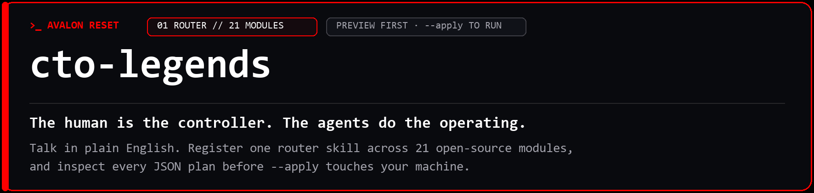
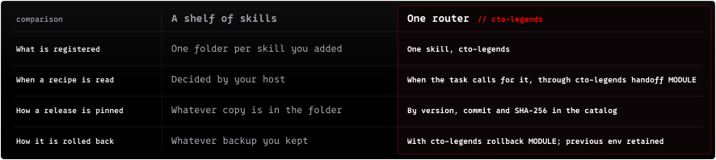

# Agent skills that work in plain English and show the plan before anything installs

[](https://github.com/avalonreset/cto-legends/releases/tag/v0.2.11) [](https://pypi.org/project/cto-legends/) [](https://github.com/avalonreset/cto-legends/actions/workflows/checks.yml) [](LICENSE)

Most **agent skills** turn you into a full-time configuration clerk, when the premise here is simple: **The human is the controller. The agents do the operating. Stop being your computer's assistant.**

Working with a coding agent is supposed to feel like briefing a sharp partner across the desk in plain English (*"study my business on Google Maps"*, *"convert my WordPress site to Astro v7"*, *"save this research in my vault"*, or *"can we generate some AI music?"*) while one lightweight router connects your session to 21 open-source modules on demand.

Type `cto-legends install legends-geogrid` and nothing gets installed. You get the plan. Add `--apply` after you have read it.

**`>_ agent handoff`** (copy and paste into Claude Code, Codex, Gemini CLI, or OpenCode)

```text
Install cto-legends from PyPI with python -m pip install cto-legends, then run
cto-legends agent-setup for this host without --apply and show me the JSON plan
before changing anything. Once I approve, run it with --apply so one router
skill can discover and preview any of the 21 Legends modules on demand.
```

**`>_ terminal quick start`** (Python 3.11+; `pip` installs the router, nothing else changes disk without `--apply`)

```sh
python -m pip install cto-legends                # PyPI v0.2.11 (CLI alias: ctolegends)
cto-legends agent-setup claude                   # 1. look: prints JSON plan, changes nothing
cto-legends agent-setup claude --apply           # 2. do: writes ~/.claude/skills/cto-legends
cto-legends route "study my business on Google Maps"
cto-legends install legends-geogrid              # 1. look: previews v0.2.7 + transport plan
cto-legends install legends-geogrid --apply      # 2. do: verifies SHA-256 and builds isolated venv
```

Installation previews run offline, and `--apply` verifies pinned GitHub release archives by SHA-256 without collecting credentials or triggering paid API calls. If you believe **agent skills** should work in plain words and show the plan before touching your machine, [star this repository on GitHub](https://github.com/avalonreset/cto-legends) so the next builder can find it.

## Stop memorizing flags: brief your agent like a partner

Eight months of daily building alongside coding agents teaches one lesson fast: creative momentum dies the minute you stop thinking about the work to hunt down CLI flags, environment variables, or package names. Productive sessions start when you state the outcome you want in ordinary speech, the same way you would hand an assignment to a trusted engineer sitting across from you.

Say what needs doing and `cto-legends route` scores your phrasing against the local catalog, returns ranked candidate modules with the exact signals that matched, and hands your agent the `handoff` command to read that module's recipe only when you are ready. Watch how four everyday requests route to a starting tool and naturally chain into sibling modules without custom glue scripts:

* **"Study my business on Google Maps"** routes straight to [`legends-geogrid`](https://github.com/avalonreset/legends-geogrid) (`0.2.7`) for circular-lattice ranking studies, local visibility grids, and 21-page HTML/PDF strategy reports. Installing GeoGrid automatically pulls in [`legends-dataforseo`](https://github.com/avalonreset/legends-dataforseo) (`0.1.11`) to carry its Google Maps SERP and Google Business Profile queries, and pairs directly with [`legends-jev`](https://github.com/avalonreset/legends-jev) (`0.2.4`) whenever you want optical verification on whether a competitor's keyword-stuffed listing matches their physical Street View storefront signage.
* **"Convert my WordPress site to Astro v7"** selects [`legends-astro`](https://github.com/avalonreset/legends-astro) (`0.2.4`), where `source-audit` ingests full-site JSON scrapes exported by [`legends-firecrawl`](https://github.com/avalonreset/legends-firecrawl) (`0.3.6`) into a typed `migration-contract.json` and scaffolds an Astro v7 Content Layer site. Once `verify-build` confirms route and `dist/` parity, [`legends-stripe`](https://github.com/avalonreset/legends-stripe) (`0.1.3`) generates drop-in checkout and webhook blueprints, [`legends-hetzner`](https://github.com/avalonreset/legends-hetzner) (`0.1.5`) sizes and provisions the Linux server, [`legends-coolify`](https://github.com/avalonreset/legends-coolify) (`0.2.3`) inspects container deployments, and [`legends-cloudflare`](https://github.com/avalonreset/legends-cloudflare) (`0.1.3`) previews the DNS cutover.
* **"Can we generate some AI music?"** connects to [`legends-stable-audio-3`](https://github.com/avalonreset/legends-stable-audio-3) (`0.1.5`), which plans instrumental music beds, sound effects, and crossfaded background mixes after checking GPU VRAM and model access before any weights download. Studio takes recorded at 4K60 AV1 through [`legends-obs`](https://github.com/avalonreset/legends-obs) (`0.1.5`) and paced source transcripts pulled by [`legends-yt-dlp`](https://github.com/avalonreset/legends-yt-dlp) (`0.1.5`) then feed [`legends-captions`](https://github.com/avalonreset/legends-captions) (`0.1.4`) for active-word `.ass` subtitles and [`legends-youtube`](https://github.com/avalonreset/legends-youtube) (`0.1.0`) for chapter packaging and SHA-256 frozen private-draft uploads.
* **"Save this research in my vault"** reaches [`legends-empire`](https://github.com/avalonreset/legends-empire) (`0.4.0`), the source-cited Markdown ontology where outputs from across the stack become durable institutional memory. Empire verifies portable [research-evidence packets](docs/RESEARCH-WORKFLOW.md) exported by DataForSEO and Firecrawl, ingests distilled voice notes from [`legends-ambient-intelligence`](https://github.com/avalonreset/legends-ambient-intelligence) (`0.1.4`), and transactionally attaches SHA-256 knowledge packs shipped inside eight sibling modules without overwriting your existing notes.

## Why one router beats a rotting shelf of agent skills

Open your **claude skills** folder in `~/.claude/skills` or your **codex skills** directory in `~/.codex/skills` after a few months of shipping real software and count what is sitting inside. Every folder was dropped in for one specific afternoon: a search wrapper from Tuesday, a deploy helper from last month, a half-forgotten formatting prompt from a weekend experiment. All of them stay on the shelf for every session that follows, competing for attention and bloating startup context on days you are building something else entirely.



Collecting separate skill folders one tool at a time always exacts the same hidden tax: bloated session startups, overlapping instructions, and stale prompts drifting behind actual CLI releases. **Avalon Reset** learned that lesson firsthand after shipping 31 standalone skills across early releases, then retired every single one behind one quiet router ([`cto_legends/SKILL.md`](cto_legends/SKILL.md)) that loads a module's operating recipe via `handoff` only on the day the job needs it.

<details>
<summary><strong>See all 31 retired standalone skill folders replaced by <code>cto-legends</code></strong></summary>

* **6 catalog-level duplicates:** `cto-legends-library`, `legends-geogrid`, `legends-dataforseo`, `legends-dataforseo-kit`, `legends-github`, `legends-empire`
* **15 vault and wiki skills folded into `legends-empire`:** `autoresearch`, `canvas`, `defuddle`, `obsidian-bases`, `obsidian-markdown`, `save`, `think`, `wiki`, `wiki-cli`, `wiki-fold`, `wiki-ingest`, `wiki-lint`, `wiki-mode`, `wiki-query`, `wiki-retrieve`
* **10 repository workflow skills folded into `legends-github`:** `github`, `github-audit`, `github-community`, `github-dataforseo`, `github-empire`, `github-legal`, `github-meta`, `github-readme`, `github-release`, `github-seo`

</details>

Cleaning out older per-module skill folders uses a reversible backup manifest rather than deleting files in place:

```sh
cto-legends agent-audit claude                   # list any retired skill folders still on the shelf
cto-legends isolate-skills claude                # 1. look: preview move plan and backup path
cto-legends isolate-skills claude --apply        # 2. do: move retired skills into ~/.cto-legends-skill-backups/<uuid>/
cto-legends restore-skills <manifest> --apply    # restore isolated folders anytime from manifest.json
```

## When the agent types the command, preview has to be the default

Paste-and-run quick starts made sense when a human read every shell line before hitting Enter. Once your coding agent has direct shell execution and runs `install`, `update`, or `sync` on its first turn, mutating disk immediately means discovering what changed after the fact.


Every state-changing command in `cto-legends` (`install`, `update`, `rollback`, `sync`, `agent-setup`, `install-skill`, `isolate-skills`, `restore-skills`, `startup-setup`, `startup-restore`, and `register-guide`) prints a deterministic JSON plan and changes nothing on disk until `--apply` is explicitly passed. Inspecting `cto-legends install legends-geogrid` at `v0.2.11` shows the exact version, commit hash, dependency chain, and scope before a single byte downloads:

```json
{
  "preview": true,
  "changes": [
    {
      "id": "legends-geogrid",
      "version": "0.2.7",
      "action": "install",
      "commit": "a3055838ab4129abbcac66d3ce2b17c7a43e1bec",
      "dependencies": {
        "legends-dataforseo": "0.1.11"
      },
      "scope": "Self-contained static HTML competitive map companion (study.py --open), circular-lattice sampling, business-name review workbench..."
    }
  ]
}
```

Passing `--apply` downloads the pinned GitHub release archive, verifies its commit SHA and SHA-256 digest against `catalog.json` (`1.0.58`), builds an isolated environment under `~/.cto-legends/releases/`, and retains your previous release on disk for instant rollback. Follow one Google Maps request from plain words to execution and watch how all seven steps stay small and inspectable:


```sh
cto-legends route "study my business on Google Maps"   # 01 route: ranked candidates + matched signals
cto-legends install legends-geogrid                    # 02 look: offline JSON install plan
cto-legends install legends-geogrid --apply            # 03 do: SHA-256 check + isolated venv
cto-legends handoff legends-geogrid                    # 04 handoff: resolve this module's recipe paths
cto-legends doctor                                     # 05 doctor: verify managed CLI health offline
cto-legends report-readiness                           # 06 readiness: check GeoGrid map/report/transport deps
cto-legends run legends-geogrid -- --help              # 07 run: execute inside your current working directory
```

Routing never triggers a hidden install, and installing never burns a paid API credit. Each step hands a clean JSON receipt to the next so you stay in control whether you type the commands yourself or let your agent drive.

## Wire your host: Claude skills, Codex skills, and portable agent skills

Builders rarely stay inside a single coding harness all week, so `cto-legends` ships named host presets that wire your preferred environment in two previewed commands. Pick a tile below or configure multiple hosts side by side on the same machine.

<p align="left">
  <a href="#claude-preset"></a><!--
  --><a href="#codex-preset"></a><!--
  --><a href="#all-9-presets"></a>
</p>

### Claude preset

Teams organizing **claude skills** often end up maintaining dozens of per-tool Markdown folders or babysitting a resident **claude code mcp** server in the background just to invoke local CLIs. Registering `cto-legends` writes one plain Markdown router to `~/.claude/skills/cto-legends/SKILL.md` with no background daemon required, while `startup-setup` links a marker-delimited capability index into `~/.claude/CLAUDE.md` backed by a SHA-256 restoration manifest.

```sh
cto-legends agent-setup claude
cto-legends agent-setup claude --apply
cto-legends startup-setup claude
cto-legends startup-setup claude --apply
```

### Codex preset

Engineers managing **codex skills** across terminal projects get both `~/.codex/skills` and the shared `~/.agents/skills` root populated in a single previewed pass. Pairing `agent-setup codex` with `startup-setup codex` updates `~/.codex/AGENTS.md` (or `$CODEX_HOME/AGENTS.md`) inside fenced `<!-- cto-legends startup:begin -->` markers while preserving every line of your surrounding instructions for `startup-restore`.

```sh
cto-legends agent-setup codex
cto-legends agent-setup codex --apply
cto-legends startup-setup codex
cto-legends startup-setup codex --apply
cto-legends startup-status codex
```

### All 9 presets

Switching editors mid-week never forces you to rebuild tool discovery, whether your daily workflow leans on **claude skills**, **codex skills**, Gemini CLI, Meta Muse, or multi-provider harnesses like OpenCode. Legacy aliases (`antigravity`/`agy`, `cursor`, `windsurf`, `aider`, `metamuse`, `qwen-code`, `zai`/`zcode`), custom directories (`cto-legends install-skill --directory /path/to/skills --apply`), and private Markdown playbooks (`cto-legends register-guide my-playbook /path/to/SKILL.md --apply`) ride the exact same router, alongside optional [AI Marketing Hub Home compatibility](docs/HOME-ADAPTER.md).

| Host preset | Skill directories written by `agent-setup` | Default `startup-setup` file |
| :--- | :--- | :--- |
| `claude` | `~/.claude/skills` | `~/.claude/CLAUDE.md` |
| `codex` | `~/.codex/skills`, `~/.agents/skills` | `~/.codex/AGENTS.md` |
| `gemini` | `~/.gemini/skills`, `~/.gemini/config/skills` | `~/.gemini/GEMINI.md` |
| `grok` | `~/.grok/skills` | `~/.grok/AGENTS.md` |
| `muse` | `~/.agents/skills` | Pass `--instruction-file ./AGENTS.md` |
| `deepseek` | `~/.deepseek/skills`, `~/.config/opencode/skills`, `~/.agents/skills` | Pass `--instruction-file ./AGENTS.md` |
| `qwen` | `~/.qwen/skills`, `~/.agents/skills` | `~/.qwen/QWEN.md` |
| `glm` | `~/.zcode/skills`, `~/.config/opencode/skills`, `~/.agents/skills` | Pass `--instruction-file ./AGENTS.md` |
| `opencode` | `~/.config/opencode/skills`, `~/.agents/skills` | `~/.config/opencode/AGENTS.md` |

## Twenty-one open-source modules, grouped by the job you ask for

Each capability lives in its own tagged open-source repository with a SHA-256 pinned release in `catalog.json` (`1.0.58`): 20 modules install into isolated CLI environments (19 Python virtualenvs plus a prebuilt Node.js 22+ CLI for `legends-obs`), while the native desktop voice app (`legends-hyperyap`) routes through `cto-legends guide legends-hyperyap` so nothing runs an OS installer uninvited. Browse the web directory at [cto-legends.com/modules](https://cto-legends.com/modules) or jump directly to [01 Local search and research](#local-search-and-research), [02 Web stack](#web-stack), [03 Recording, audio and video](#recording-audio-and-video), and [04 Memory](#memory).

<a id="local-search-and-research"></a>


Gather live Google Maps rank grids, SERP demand, Street View signage proofs, clean site crawls, repository SEO audits, and non-dilutive grant opportunities through six research modules.

| Module | Plain-English prompt example | What it does |
| :--- | :--- | :--- |
| [`legends-geogrid`](https://github.com/avalonreset/legends-geogrid) `0.2.7` | *"study my business on Google Maps"* | Runs circular-lattice Google Maps rank grids, GBP title audits, and 21-page HTML/PDF strategy reports (auto-installs `legends-dataforseo`) |
| [`legends-dataforseo`](https://github.com/avalonreset/legends-dataforseo) `0.1.11` | *"pull SERP rankings and keyword demand for this domain"* | Queries SERP rankings, keyword demand, Google Business Profile tasks, `/goto` redirect unmasking, and portable evidence packets |
| [`legends-jev`](https://github.com/avalonreset/legends-jev) `0.2.4` | *"check whether these GBP titles match Street View signage"* | Performs typed OCR, optical grounding, and Street View storefront signage verification on supplied competitor imagery |
| [`legends-firecrawl`](https://github.com/avalonreset/legends-firecrawl) `0.3.6` | *"crawl this documentation site into clean Markdown"* | Executes full-site crawls, structured page scrapes, SERP inner-URL resolution (`resolve`), and portable evidence exports |
| [`legends-github`](https://github.com/avalonreset/legends-github) `0.2.4` | *"audit our repository releases, topics, and search demand"* | Audits repository releases, DataForSEO keyword demand, README/topic metadata, social previews, and release readiness |
| [`legends-grant`](https://github.com/avalonreset/legends-grant) `0.3.3` | *"find non-dilutive grants and track our application deadlines"* | Discovers and scores business, nonprofit, tribal, and government grants with eligibility checks and proposal rendering |

<a id="web-stack"></a>


Size cloud servers, monitor container deployments, migrate legacy sites to Astro v7, wire Cloudflare DNS and Stripe billing, and govern CRM sub-accounts or private Nostr relays across seven infrastructure tools.

| Module | Plain-English prompt example | What it does |
| :--- | :--- | :--- |
| [`legends-hetzner`](https://github.com/avalonreset/legends-hetzner) `0.1.5` | *"size and preview a Hetzner Cloud server for Coolify"* | Scans Cost-Optimized CX/CAX stock, sizes Hetzner Cloud servers, runs 10-check preflights, and guards VPS provisioning |
| [`legends-coolify`](https://github.com/avalonreset/legends-coolify) `0.2.3` | *"check application health and deployments on our Coolify host"* | Inspects Coolify server inventories, deployment histories, container health, environment variable names, and backup plans |
| [`legends-cloudflare`](https://github.com/avalonreset/legends-cloudflare) `0.1.3` | *"audit DNS records and preview zone updates on Cloudflare"* | Inventories Cloudflare zones and DNS records, checks nameservers, and runs preview-first DNS upserts with live readback |
| [`legends-astro`](https://github.com/avalonreset/legends-astro) `0.2.4` | *"convert my WordPress site to Astro v7"* | Extracts migration contracts (`source-audit`) from Firecrawl scrapes, scaffolds Astro v7 Content Layer sites, and checks `dist/` parity |
| [`legends-stripe`](https://github.com/avalonreset/legends-stripe) `0.1.3` | *"inspect Stripe products, price maps, and webhook endpoints"* | Lints Stripe catalogs, governs `.env` price IDs, tracks fee drag and dunning, and emits Astro v7 checkout/webhook blueprints |
| [`legends-gohighlevel`](https://github.com/avalonreset/legends-gohighlevel) `0.3.5` | *"review GoHighLevel pipelines, snapshots, and rebilling settings"* | Governs GoHighLevel CRM pipelines, Workflows v3, Voice/Conversation AI, Snapshots V2 batch cloning, and SaaS rebilling |
| [`legends-buzz`](https://github.com/avalonreset/legends-buzz) `0.1.1` | *"probe readiness and NIP-29 groups on our Block Buzz relay"* | Operates self-hosted Block Buzz Nostr relays with readiness probes, NIP-29 membership diagnostics, and 26-domain agent routing |

<a id="recording-audio-and-video"></a>


Capture 4K60 studio sessions, dictate locally at the cursor, transcribe voice recorders, align active-word subtitles, score instrumental music beds, and package frozen YouTube drafts with seven creative studio tools.

| Module | Plain-English prompt example | What it does |
| :--- | :--- | :--- |
| [`legends-obs`](https://github.com/avalonreset/legends-obs) `0.1.5` | *"verify OBS Studio scenes and run a 4K60 recording canary"* | Inspects OBS Studio profiles, verifies scenes, and runs 4K60 AV1 recording canaries via a prebuilt Node 22+ CLI |
| [`legends-captions`](https://github.com/avalonreset/legends-captions) `0.1.4` | *"render active-word .ass captions from this transcript"* | Normalizes technical terms, aligns word timing, renders active-word `.ass` subtitles, and exports visual proof frames |
| [`legends-youtube`](https://github.com/avalonreset/legends-youtube) `0.1.0` | *"package chapters and check quota budget for our YouTube channel"* | Plans YouTube API quota waves, runs retention X-rays, lints chapters and quizzes, and uploads SHA-256 frozen private drafts |
| [`legends-yt-dlp`](https://github.com/avalonreset/legends-yt-dlp) `0.1.5` | *"pull transcripts and build clips from this video"* | Pulls paced video and transcripts, verifies downloaded sources, searches captions, and builds repeatable clips |
| [`legends-stable-audio-3`](https://github.com/avalonreset/legends-stable-audio-3) `0.1.5` | *"can we generate some AI music?"* | Plans VRAM-aware instrumental music beds, sound effects, and crossfaded continuous mixes before any weights download |
| [`legends-hyperyap`](https://github.com/avalonreset/legends-hyperyap) `0.1.4` | *"show setup instructions for HyperYap local voice dictation"* | Guides native desktop voice typing, dictation, and app-focused paste across Windows, macOS, and Linux (`cto-legends guide legends-hyperyap`) |
| [`legends-ambient-intelligence`](https://github.com/avalonreset/legends-ambient-intelligence) `0.1.4` | *"transcribe our studio voice recorder audio into vault notes"* | Captures and deduplicates continuous audio, runs offline Whisper/NeMo transcription, and distills cited vault notes |

<a id="memory"></a>


Turn scattered rank grids, site crawls, grant packets, and studio transcripts into a permanent, source-cited Markdown vault instead of losing hard-won research inside chat scrollback.

| Module | Plain-English prompt example | What it does |
| :--- | :--- | :--- |
| [`legends-empire`](https://github.com/avalonreset/legends-empire) `0.4.0` | *"save this research in my vault"* | Maintains a source-cited Markdown ontology with `legends-vault-stewardship`, verified `research-evidence` intake, attachable module knowledge packs, and optional Home adapter support |

## Day-two upkeep and CLI reference

Keeping your catalog and installed modules current follows the exact same look-then-do rhythm as day one, while the single skill registered in your coding agent never needs to be replaced. Upgrades probe the new environment before switching the active pointer and retain your prior release on disk for instant offline rollback:

```sh
cto-legends check-updates                    # compare installed, local catalog, and upstream pins
cto-legends sync                             # 1. look: preview upstream catalog changes
cto-legends sync --apply                     # 2. do: adopt new catalog and retain previous copy
cto-legends update                           # 1. look: preview upgrades for installed modules
cto-legends update --apply                   # 2. do: build and probe updated module environments
cto-legends rollback legends-geogrid         # 1. look: preview retained prior environment
cto-legends rollback legends-geogrid --apply # 2. do: switch back without re-downloading
```

Expand the reference drawers below whenever you need the full 24-command CLI surface or local storage and verification details:

<details>
<summary><strong>Full 24-command CLI reference (JSON-first subcommands and flags)</strong></summary>

Both `cto-legends` and the un-hyphenated `ctolegends` binary (plus `python -m cto_legends` and `python -m ctolegends`) accept identical arguments and emit structured JSON by default (`capabilities --markdown` outputs human-readable Markdown). Pass `--no-remote-peek` on `route` or `handoff` when running in strictly offline environments.

| Group | Command | Preview / disk behavior | What it returns |
| :--- | :--- | :--- | :--- |
| Discovery | `cto-legends route "<goal>" [--no-remote-peek]` | Read-only | Ranked candidate modules with matched signals, purpose, scope, and `handoff` command |
| Discovery | `cto-legends handoff <module> [--no-remote-peek]` | Read-only | Installed recipe paths, setup guidance, and non-blocking upstream update hints |
| Discovery | `cto-legends capabilities [--markdown]` | Read-only | Outcome-grouped capability directory across catalog modules and registered local `.md` guides |
| Discovery | `cto-legends guide <module>` | Read-only | Pinned setup instructions, platform requirements, license, and release URLs for guided modules |
| Discovery | `cto-legends catalog` | Read-only | Active `catalog.json` (`1.0.58`) with pinned versions, commit hashes, and SHA-256 archive digests |
| Lifecycle | `cto-legends install <modules...> [--apply]` | Previews unless `--apply` | Offline install plan (`preview: true`), or verified archive extraction and isolated env build |
| Lifecycle | `cto-legends run <module> -- <args...>` | Runs in current working dir | Executes the installed module CLI inside your working directory without shell interpolation |
| Lifecycle | `cto-legends status` | Read-only | Active release paths, runtime interpreters, retained rollback versions, and registered local guides |
| Lifecycle | `cto-legends check-updates` | Read-only | Drift report comparing installed releases, active local catalog pins, and upstream tags |
| Lifecycle | `cto-legends sync [--apply] [--rollback]` | Previews unless `--apply` | Previews or adopts the upstream catalog snapshot (or restores `catalog.previous.json`) |
| Lifecycle | `cto-legends update [modules...] [--apply]` | Previews unless `--apply` | Previews or upgrades installed modules to match your active catalog's release pins |
| Lifecycle | `cto-legends rollback <module> [--apply]` | Previews unless `--apply` | Previews or switches an installed module back to its retained previous environment |
| Readiness | `cto-legends doctor` | Read-only | Offline import, CLI, and version-floor health probes across installed managed modules |
| Readiness | `cto-legends report-readiness` | Read-only | Verifies `legends-geogrid` report libraries, basemap helpers, and DataForSEO client wiring |
| Readiness | `cto-legends task-readiness [all\|reports\|research\|evidence\|github]` | Read-only | Checks headless Chromium (`--browser-library-directory PATH` on Linux), artwork libraries, and env keys |
| Host & shelf | `cto-legends agent-setup <host> [--directory PATH] [--apply]` | Previews unless `--apply` | Previews or writes `cto-legends/SKILL.md` into the selected host preset's skill root(s) |
| Host & shelf | `cto-legends install-skill --directory PATH [--apply]` | Previews unless `--apply` | Previews or writes `cto-legends/SKILL.md` into an explicit custom skill directory |
| Host & shelf | `cto-legends agent-audit <host> [--directory PATH]` | Read-only | Scans host skill folders for the 31 retired standalone skill names replaced by this router |
| Host & shelf | `cto-legends isolate-skills <host> [--directory PATH] [--apply]` | Previews unless `--apply` | Moves overlapping retired skill folders into a manifest-tracked backup directory |
| Host & shelf | `cto-legends restore-skills <manifest> [--apply]` | Previews unless `--apply` | Restores isolated skill folders from a backup `manifest.json` receipt |
| Host & shelf | `cto-legends startup-setup <host> [--instruction-file PATH] [--apply]` | Previews unless `--apply` | Writes or refreshes the fenced startup capability index with a SHA-256 backup manifest |
| Host & shelf | `cto-legends startup-status <host> [--instruction-file PATH]` | Read-only | Reports whether the host's startup instruction block is present and matches the active index |
| Host & shelf | `cto-legends startup-restore <manifest> [--apply]` | Previews unless `--apply` | Restores a host startup instruction file from its verified backup manifest |
| Host & shelf | `cto-legends register-guide <name> <path.md> [--apply]` | Previews unless `--apply` | Registers a user-selected local `.md` playbook in `local-guides.json` without executing code |

</details>

<details>
<summary><strong>Disk layout, SHA-256 verification, testing, and license details</strong></summary>

Managed module releases, synced catalogs, `local-guides.json`, and `install.log` build traces live under `~/.cto-legends` by default (override with `CTO_LEGENDS_HOME` or pass `--home PATH` before any subcommand). Running `install --apply` or `update --apply` downloads the pinned release archive from GitHub and verifies its SHA-256 digest and commit hash against `catalog.json` before creating an isolated release directory under `~/.cto-legends/releases/<module>/`.

Contributors running local checks can execute the unit test suite and package verification with standard Python 3.11+ tooling:

```sh
python -m unittest discover -s tests -v
python -m pip install build twine
python -m build
python -m twine check dist/*
```

Architecture contracts, host wiring details, and security policies live in [`docs/ARCHITECTURE.md`](docs/ARCHITECTURE.md), [`docs/CAPABILITY-DISCOVERY.md`](docs/CAPABILITY-DISCOVERY.md), [`docs/AGENT-HOSTS.md`](docs/AGENT-HOSTS.md), [`docs/STARTUP.md`](docs/STARTUP.md), [`CONTRIBUTING.md`](CONTRIBUTING.md), and [`SECURITY.md`](SECURITY.md). `cto-legends` is released under the [MIT License](LICENSE), while module-level terms (`Apache-2.0` on `legends-stable-audio-3`, `AGPL-3.0` on `legends-hyperyap`, and `GPL-2.0-or-later` on the optional OBS cursor extra) are listed in [`THIRD_PARTY_NOTICES.md`](THIRD_PARTY_NOTICES.md).

</details>

## Put one router to work

Two commands take any Python 3.11+ shell from zero to a previewed host registration:

```sh
python -m pip install cto-legends
cto-legends agent-setup claude && cto-legends agent-setup claude --apply
```

Give this repository a [star on GitHub](https://github.com/avalonreset/cto-legends) if you think **agent skills** should keep your context clean and show their plan before changing a single file.

Founders, operators, and technical leaders who want this way of working applied directly to their own stack can send a note to the async message desk at [cto-legends.com/dm](https://cto-legends.com/dm), built and maintained by **Avalon Reset**.

[](https://cto-legends.com/dm)
