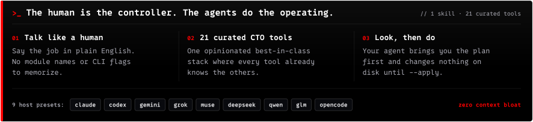
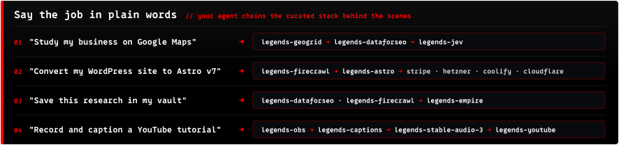
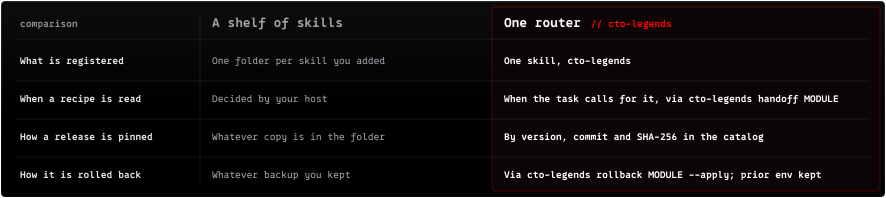
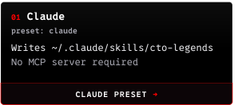
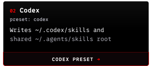
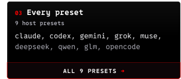

<p align="center"></p>

# cto-legends: agent skills that let you speak in plain English across 21 curated tools

[](https://pypi.org/project/cto-legends/)
[](pyproject.toml)
[](LICENSE)
[](#the-21-curated-modules)
[](#why-your-agent-shows-the-plan-before-anything-changes)

For decades, computers forced human beings to think like machines. You hunted for packages, memorized flags, and tippity-typed system commands into a terminal. Coding agents were supposed to end that, yet most agent skills setups quietly turn you back into the computer's assistant.

**The human is the controller. The agents do the operating. Stop being your computer's assistant.**

Your coding agent registers one small skill, once. From that moment on, you state what you want in plain English the way you would brief a sharp colleague across the desk, and your agent reaches into a curated stack of 21 open-source modules, loads the right playbook on demand, and brings you a plan to approve.

<p align="center"></p>

```text
Install cto-legends for me. Run: python -m pip install cto-legends
Then run cto-legends agent-setup for the host you are running in, show me the
preview, and add --apply only after I say go. From then on, when I describe a
job in plain English, find the right module and show me the plan before --apply.
```

Prefer to run the first step in your own terminal? Three lines do the entire setup:

```sh
python -m pip install cto-legends
cto-legends agent-setup claude          # look: prints the plan, changes nothing
cto-legends agent-setup claude --apply  # do: registers the one router skill
```

<p align="center"></p>

[Plain English](#agent-skills-in-plain-english) · [Curated stack](#why-a-curated-stack-beats-a-pile-of-claude-skills-and-codex-skills) · [Plan first](#why-your-agent-shows-the-plan-before-anything-changes) · [Host setup](#host-setup-claude-skills-codex-skills-and-7-more-presets) · [The 21 modules](#the-21-curated-modules) · [Reference](#reference)

---

## Agent skills in plain English

Nobody who uses this describes it to a friend as a router or a CLI manager. They say: you tell your coding agent what you want in normal words, and it already knows which tools to combine to get the job done.

Months of building with coding agents every day taught this project one plain lesson: momentum dies the minute you stop thinking about your business or your build to hunt for a CLI flag, an environment variable, or a package name. The best sessions feel like a conversation across a desk. You state the outcome, and the stack assembles itself behind the scenes.

<p align="center"></p>

Start where a human actually starts, with a sentence. Here are four the stack was built to answer.

**"Study my business on Google Maps."**

Your agent asks the router and gets back ranked candidates with clear reasons, not a blind guess. [`legends-geogrid`](https://github.com/avalonreset/legends-geogrid) leads the plan and pairs with [`legends-dataforseo`](https://github.com/avalonreset/legends-dataforseo) alongside it, combining city-wide Maps ranking grids with live Search demand, Business Profile audits, and visibility checks across Google AI Mode and LLM Mentions. Add [`legends-jev`](https://github.com/avalonreset/legends-jev) and your agent can verify whether the keywords stuffed into a competitor's Maps title actually appear on the physical sign above their storefront door.

**"Convert my WordPress site to Astro v7."**

Migrations land on [`legends-astro`](https://github.com/avalonreset/legends-astro), and it never works alone. [`legends-firecrawl`](https://github.com/avalonreset/legends-firecrawl) scrapes the legacy pages, runs interactive browser sessions when a site hides behind dynamic scripts, parses local PDFs, Word documents, and spreadsheets into clean Markdown, and queries structured data through Alexandria. Astro's source audit turns that harvest into a strict migration contract covering every URL, title, canonical tag, and structured data block.

Once the pages build cleanly, the rest of the web infrastructure lines up in order. [`legends-stripe`](https://github.com/avalonreset/legends-stripe) audits price IDs and verifies payment webhooks, [`legends-hetzner`](https://github.com/avalonreset/legends-hetzner) sizes the cloud server, [`legends-coolify`](https://github.com/avalonreset/legends-coolify) inspects the deployment pipeline, and [`legends-cloudflare`](https://github.com/avalonreset/legends-cloudflare) cuts the DNS over with a reviewed change plan.

**"Save this research in my vault."**

[`legends-empire`](https://github.com/avalonreset/legends-empire) is the long-term memory that the rest of the stack writes into. Search and scraping tools export portable evidence packages bound to a SHA-256 manifest, and Empire verifies every file before planning it into your Markdown vault. With ontology queries, vault stewardship, and instant vault search built in, research you paid for on Tuesday is ready to query on Friday instead of bought twice.

**"Can we generate some AI music?"**

[`legends-stable-audio-3`](https://github.com/avalonreset/legends-stable-audio-3) installs as a lightweight planner that checks your local GPU and model access before it downloads a single weight file. Once your instrumental score or sound effect renders, it flows straight into the studio chain: underneath a screen recording configured by [`legends-obs`](https://github.com/avalonreset/legends-obs), paired with active-word subtitles rendered by [`legends-captions`](https://github.com/avalonreset/legends-captions), and packaged by [`legends-youtube`](https://github.com/avalonreset/legends-youtube) into a verified private draft upload.

Four everyday sentences, zero module names typed, and zero CLI flags memorized. Your agent connects the tools because the tools were designed as one family from day one, so you never have to play switchboard operator.

## Why a curated stack beats a pile of Claude skills and Codex skills

In a sea of infinite options, a directory of five hundred unvetted plugins is not help. It is more homework.

Nobody wants a bookmark list of every package on GitHub. You want the internet boiled down to the one stack where every piece is vetted, maintained, and built to pass data cleanly to the next: 21 specific tools across local search, web hosting, site migration, payments, CRM, studio production, voice dictation, and vault memory.

Compare that with how most people manage Claude skills and Codex skills today. You find a repo, drop a folder into `~/.claude/skills`, copy it into `~/.codex/skills`, and repeat that twenty times until your agent has two diverging shelves of stale instructions. Worse, if you wire up fifteen separate `claude code mcp` servers, every single session pays a permanent context-window tax before you even say hello.

<p align="center"></p>

`cto-legends` asks your agent to register one lightweight router skill in total. All 21 modules stay off the shelf until a sentence you speak calls for one. When it does, your agent runs `cto-legends handoff` and reads that single module's playbook on demand. Because the router is a plain Markdown skill backed by a local CLI, no background daemon or resident `claude code mcp` server ever sits in memory eating tokens between turns.

## Why your agent shows the plan before anything changes

When you speak in plain English and let your coding agent drive, you only need one guarantee: the agent proposes, and you approve.

Every quick start on the internet was written for an era when a human read the command before pressing Enter. Now your coding agent is the one typing. It types at machine speed, with total confidence, and without pausing to wonder what an install script is about to do to your global Python environment.

That is why `cto-legends` flips the default. The first line of its CLI source is the entire contract:

```python
"""JSON-first CLI; mutations preview unless --apply is explicit."""
```

Eleven commands can change something on your machine (`install`, `update`, `rollback`, `sync`, `agent-setup`, `install-skill`, `isolate-skills`, `restore-skills`, `startup-setup`, `startup-restore`, and `register-guide`), and every one follows the same rule. Run any of them without `--apply` and nothing changes on disk. On a fresh machine, a preview does not even create the `~/.cto-legends` directory. It prints the exact release pin, commit hash, dependencies, and scope so your agent can show you the plan in plain sight.

Once you say go and your agent adds `--apply`, the hub does the careful version of the work. It verifies the download against a pinned SHA-256 digest, unpacks the tool into its own isolated environment so dependencies never collide with your project, and keeps your previous working environment intact on disk for instant one-command `rollback`.

Underneath every plain-English request, your agent runs the same clean sequence:

```sh
cto-legends route "study my business on Google Maps"  # 1 route: ranked candidates, with reasons
cto-legends install legends-geogrid                   # 2 look: prints the plan, changes nothing
cto-legends install legends-geogrid --apply           # 3 do: SHA-256 verified, isolated environment
cto-legends handoff legends-geogrid                   # 4 handoff: loads this one recipe on demand
cto-legends run legends-geogrid -- --help             # 5 run: executes inside its own environment
cto-legends rollback legends-geogrid --apply          # 6 rollback: previous env stays ready on disk
```

Routing never triggers a hidden download, and installing never burns a paid API credit. You get the ease of speaking to a colleague, backed by the discipline of a systems engineer.

---

## Host setup: Claude skills, Codex skills and 7 more presets

Pick your coding agent host. Every preset previews its file paths first, writes the single router skill into that host's standard directory, and never overwrites a file you have customized by hand. Whether you rely on Claude skills, Codex skills, or switch between nine different harnesses, every agent reads the same router contract.

<p align="center">
  <a href="#claude-preset"></a><!--
  --><a href="#codex-preset"></a><!--
  --><a href="#all-9-presets"></a>
</p>

### Claude preset

```sh
cto-legends agent-setup claude            # look: previews the target skill path
cto-legends agent-setup claude --apply    # do: writes ~/.claude/skills/cto-legends/SKILL.md
cto-legends startup-setup claude          # look: optional capability pointer for ~/.claude/CLAUDE.md
cto-legends startup-setup claude --apply  # do: writes one marked block with a backup manifest
```

Reload your skills and ask a real question: *Can we generate some AI music?* There is no background server to launch and no JSON schema wall to debug. The optional `startup-setup` command places a compact marked pointer to your local capability index into your host's root instruction file, and `startup-restore` removes it cleanly from the backup manifest whenever you like.

### Codex preset

```sh
cto-legends agent-setup codex             # look: previews the target skill paths
cto-legends agent-setup codex --apply     # do: writes ~/.codex/skills and ~/.agents/skills
cto-legends startup-setup codex           # look: optional capability pointer for ~/.codex/AGENTS.md
cto-legends startup-setup codex --apply   # do: writes one marked block with a backup manifest
```

Same router, same conversational workflow, same preview before anything touches disk. If you set `CODEX_HOME`, both commands follow it automatically.

### All 9 presets

| Preset | Skill folders `agent-setup` writes | Default `startup-setup` file |
| --- | --- | --- |
| `claude` | `~/.claude/skills` | `~/.claude/CLAUDE.md` |
| `codex` | `~/.codex/skills`, `~/.agents/skills` | `~/.codex/AGENTS.md` |
| `gemini` | `~/.gemini/skills`, `~/.gemini/config/skills` | `~/.gemini/GEMINI.md` |
| `grok` | `~/.grok/skills` | `~/.grok/AGENTS.md` |
| `muse` | `~/.agents/skills` | pass `--instruction-file <path>` |
| `deepseek` | `~/.deepseek/skills`, `~/.config/opencode/skills`, `~/.agents/skills` | pass `--instruction-file <path>` |
| `qwen` | `~/.qwen/skills`, `~/.agents/skills` | `~/.qwen/QWEN.md` |
| `glm` | `~/.zcode/skills`, `~/.config/opencode/skills`, `~/.agents/skills` | pass `--instruction-file <path>` |
| `opencode` | `~/.config/opencode/skills`, `~/.agents/skills` | `~/.config/opencode/AGENTS.md` |

Add `--apply` to any preset after reviewing its preview. For a custom skills directory anywhere on disk, run `cto-legends install-skill --directory <folder> --apply`. Any coding agent without native skill loading can read [cto_legends/SKILL.md](cto_legends/SKILL.md) and call the CLI directly.

You can also route your own internal team playbooks through the same hub. Running `cto-legends register-guide <name> <path.md> --apply` registers a local Markdown guide so `handoff` resolves it alongside the 21 public modules.

## The 21 curated modules

Every module is an independent open-source repository with its own test suite and release pins, and you never need to memorize their names. They are listed below so you can see how far a single plain-English request reaches. Browse the interactive specs at [cto-legends.com/modules](https://cto-legends.com/modules), or view all 22 repositories in one place in the [CTO Legends GitHub collection](https://github.com/stars/avalonreset/lists/cto-legends).

Twenty modules install as managed local CLIs inside their own isolated release folders (19 Python virtual environments plus the prebuilt `legends-obs` Node CLI). The one native desktop application, `legends-hyperyap`, routes through `cto-legends guide legends-hyperyap` so the router never triggers an operating system installer behind your back.

<a id="local-search-and-research"></a>

<p align="center"><a href="#local-search-and-research"></a></p>

See where a business or product actually stands across Google, Maps, and AI answer engines, and keep the evidence so you never pay for the same lookup twice.

| Module | Say something like | What it does |
| --- | --- | --- |
| [`legends-geogrid`](https://github.com/avalonreset/legends-geogrid) | "Where does my pizza shop rank on Google Maps across the city?" | Google Maps ranking grids, competitive studies and a 21-page strategy report in PDF and HTML |
| [`legends-dataforseo`](https://github.com/avalonreset/legends-dataforseo) | "Check our Google AI Mode visibility and keyword demand" | Google AI Mode, LLM Mentions, Search, Maps, Business Profile and keyword research, with saved offline evidence |
| [`legends-jev`](https://github.com/avalonreset/legends-jev) | "Read the text on this storefront photo and verify the sign" | Optical recognition, storefront signage verification and advice on the next computer-use action |
| [`legends-firecrawl`](https://github.com/avalonreset/legends-firecrawl) | "Turn this website and its PDF brochures into clean Markdown" | Web scraping, local PDF and document-to-Markdown parsing, interactive browser sessions, paper search and Alexandria data queries |
| [`legends-github`](https://github.com/avalonreset/legends-github) | "Improve how developers discover my GitHub repository" | Researches search demand, then improves repository copy, metadata, presentation and releases |
| [`legends-grant`](https://github.com/avalonreset/legends-grant) | "Find US grants for a small business or nonprofit" | Discovers US grants, reviews eligibility and drafts evidence-linked proposals |

<a id="web-stack"></a>

<p align="center"><a href="#web-stack"></a></p>

Move from a scraped legacy site to a live production server taking payments and syncing CRM pipelines, one reviewed plan at a time.

| Module | Say something like | What it does |
| --- | --- | --- |
| [`legends-hetzner`](https://github.com/avalonreset/legends-hetzner) | "Check my Hetzner project and plan a new server" | Inspects Hetzner Cloud projects, scans Cost-Optimized stock and prepares reviewed server plans |
| [`legends-coolify`](https://github.com/avalonreset/legends-coolify) | "Inspect my Coolify applications and deployment logs" | Read-only Coolify operations and source-cited runbooks |
| [`legends-cloudflare`](https://github.com/avalonreset/legends-cloudflare) | "Preview a DNS cutover before applying it" | Cloudflare DNS automation with reviewed change plans and readback checks |
| [`legends-astro`](https://github.com/avalonreset/legends-astro) | "Convert my WordPress export to an Astro v7 site and verify parity" | Astro v7 migrations, source contract extraction and build parity checks |
| [`legends-stripe`](https://github.com/avalonreset/legends-stripe) | "Audit my .env file against Stripe and check for mismatched price IDs" | Stripe governance: price-ID audits, catalog lint, hosted invoicing, fee telemetry and webhook verification |
| [`legends-gohighlevel`](https://github.com/avalonreset/legends-gohighlevel) | "Audit my GoHighLevel sub-account health, pipelines and workflows" | GoHighLevel CRM, workflows and agency governance, with preview-first changes and API readback |
| [`legends-buzz`](https://github.com/avalonreset/legends-buzz) | "Check why my Buzz agent gets HTTP 403 when the relay is healthy" | Self-hosted Buzz relay operations, membership diagnostics and agent routing |

<a id="recording-audio-and-video"></a>

<p align="center"><a href="#recording-audio-and-video"></a></p>

Record your screen, score it with local AI audio, render active-word captions, and ship a verified private YouTube draft, with your own voice as the keyboard.

| Module | Say something like | What it does |
| --- | --- | --- |
| [`legends-obs`](https://github.com/avalonreset/legends-obs) | "Prepare OBS scenes for a 4K tutorial recording" | Inspects, configures and verifies OBS Studio recording workflows (live OBS control targets Windows) |
| [`legends-captions`](https://github.com/avalonreset/legends-captions) | "Caption this video with active-word timing" | Caption QA and rendering with contextual correction, alignment timing and proof evidence |
| [`legends-youtube`](https://github.com/avalonreset/legends-youtube) | "Validate my chapters and thumbnail before freezing a private draft upload" | Channel operations: lossless metadata updates, quota planning, scorecards and frozen private-draft uploads |
| [`legends-yt-dlp`](https://github.com/avalonreset/legends-yt-dlp) | "Archive this video channel with transcripts" | Repeatable source pulls, verification, transcripts, search and clip-building |
| [`legends-stable-audio-3`](https://github.com/avalonreset/legends-stable-audio-3) | "Can we generate some AI music?" | Instrumental music, sound effects and continuous mixes |
| [`legends-hyperyap`](https://github.com/avalonreset/legends-hyperyap) | "Let me type with my voice in any app" | Local voice typing, dictation and app-focused paste |
| [`legends-ambient-intelligence`](https://github.com/avalonreset/legends-ambient-intelligence) | "Transcribe my voice memos offline and distill key notes" | Ambient audio capture, deduplicated archiving, offline transcription and vault distillation |

<a id="memory"></a>

<p align="center"><a href="#memory"></a></p>

Memory is the vault that every other module writes into, so tomorrow's session begins with everything today's session proved.

| Module | Say something like | What it does |
| --- | --- | --- |
| [`legends-empire`](https://github.com/avalonreset/legends-empire) | "Save this research in my vault and index it" | Markdown vault memory, instant vault search, hash-verified research intake and ontology stewardship |

## Reference

Everything you need to use `cto-legends` with your coding agent is in the essay above. Open these two drawers whenever you want the full command table or filesystem layout.

<details>
<summary><strong>The full CLI: all 24 commands</strong></summary>

<br>

Every command returns structured JSON. A "yes" in the final column means the command prints its preview plan and changes nothing on disk until you add `--apply`.

| Group | Command | What it does | Look, then do |
| --- | --- | --- | --- |
| Discovery | `route "<goal>"` | Finds modules for a plain-English goal and returns ranked candidates with reasons | |
| Discovery | `capabilities [--markdown]` | Reads the outcome-based capability index offline | |
| Discovery | `handoff <module>` | Resolves one module's instructions without registering another skill | |
| Discovery | `guide <module>` | Shows pinned setup instructions, platform requirements and release downloads | |
| Discovery | `catalog` | Lists the bundled, verified module set | |
| Lifecycle | `status` | Shows managed paths and installed versions | |
| Lifecycle | `install <module ...>` | Installs modules from pinned, verified releases | yes |
| Lifecycle | `update [module ...]` | Updates the named modules, or every installed module when none are named | yes |
| Lifecycle | `rollback <module>` | Switches a module back to its retained previous environment | yes |
| Lifecycle | `run <module> -- <args>` | Runs an installed module; everything after `--` goes straight to it | |
| Lifecycle | `check-updates` | Compares installed, catalog and upstream versions without installing | |
| Lifecycle | `sync [--rollback]` | Refreshes the catalog; `--rollback` reverts to the previous one | yes |
| Readiness | `doctor` | Checks installed environments without provider API calls | |
| Readiness | `task-readiness [task]` | Offline checks for task prerequisites: `all`, `reports`, `research`, `evidence` or `github` | |
| Readiness | `report-readiness` | Checks GeoGrid reports, map browser and transport without paid calls | |
| Host and shelf | `agent-setup <host>` | Registers the router skill for an agent host | yes |
| Host and shelf | `install-skill --directory <folder>` | Registers the router in an explicit skills folder | yes |
| Host and shelf | `agent-audit <host>` | Lists retired standalone skills still in a host's folders | |
| Host and shelf | `isolate-skills <host>` | Moves those skills into a manifest-tracked backup | yes |
| Host and shelf | `restore-skills <manifest>` | Puts isolated skills back from their manifest | yes |
| Host and shelf | `startup-setup <host>` | Writes the capability index into the host's startup instruction file, with a backup | yes |
| Host and shelf | `startup-status <host>` | Inspects the startup contract for a host | |
| Host and shelf | `startup-restore <manifest>` | Restores a startup change from its checked backup | yes |
| Host and shelf | `register-guide <name> <path>` | Registers one of your own local Markdown guides so `handoff` can resolve it | yes |

Staying current follows the exact same look-then-do rhythm:

```sh
cto-legends check-updates                     # compare installed, catalog and upstream; installs nothing
cto-legends sync                              # look: preview a catalog refresh
cto-legends sync --apply                      # do: adopt the refreshed catalog
cto-legends update                            # look: see which installed modules would move
cto-legends update --apply                    # do: upgrade them in isolated environments
cto-legends rollback legends-geogrid          # look: preview the kept release it would switch to
cto-legends rollback legends-geogrid --apply  # do: switch back to the retained working environment
```

Global options: `--home <path>` moves the managed home folder, and `--version` prints the installed version. The CLI answers to `cto-legends`, `ctolegends`, `python -m cto_legends` and `python -m ctolegends`.

</details>

<details>
<summary><strong>Disk, verification and license notes</strong></summary>

<br>

- **Where it lives.** Everything the hub manages sits under `~/.cto-legends` (override it with `--home` or the `CTO_LEGENDS_HOME` environment variable). Managed modules unpack under `~/.cto-legends/releases/` into isolated per-release folders (dedicated virtual environments for Python modules and a self-contained prebuilt package for `legends-obs`), so modules never share dependencies with each other or pollute your project packages.
- **What gets verified.** Every release in the bundled catalog is pinned by version, commit hash and SHA-256 digest. Running `--apply` verifies the downloaded archive against that cryptographic pin before building the virtual environment. Run `cto-legends catalog` at any time to inspect every pin.
- **How you go back.** When a module updates, the previous environment stays on disk so `cto-legends rollback <module> --apply` restores your prior working version in one step without a new download. The catalog keeps a rollback copy too, and any interrupted install writes full diagnostics to `install.log`.
- **Refused paths.** Managed paths reject symlinks, Windows junctions and reparse points.
- **Requirements.** Python 3.11 or newer. Running `cto-legends doctor` also checks whether optional host binaries (`node`, `pnpm` and `gh`) are available on your `PATH`.
- **More hosts.** Beyond the nine main presets, `agent-setup` also accepts `antigravity` (alias `agy`), `cursor`, `windsurf` and `aider`, plus the aliases `metamuse`, `qwen-code`, `zai` and `zcode`.
- **Old names still work.** Twelve earlier module names resolve automatically as aliases, and the retired `legends-obsidian` slug maps cleanly to `legends-empire`.
- **Licenses.** `cto-legends` is [MIT](LICENSE). Nineteen of the 21 modules are MIT, `legends-stable-audio-3` is Apache-2.0, `legends-hyperyap` is AGPL-3.0 and the optional OBS cursor overlay extra is GPL-2.0-or-later, all documented in [THIRD_PARTY_NOTICES.md](THIRD_PARTY_NOTICES.md) beside [NOTICE](NOTICE).
- **Deeper docs.** [Architecture](docs/ARCHITECTURE.md), [capability discovery](docs/CAPABILITY-DISCOVERY.md), [agent hosts](docs/AGENT-HOSTS.md), [startup](docs/STARTUP.md), [research workflow](docs/RESEARCH-WORKFLOW.md), [Home adapter](docs/HOME-ADAPTER.md), [contributing](CONTRIBUTING.md) and [security](SECURITY.md).

Contributors can run the release verification suite locally:

```sh
python -m unittest discover -s tests -v
python -m pip install build twine
python -m build
python -m twine check dist/*
```

</details>

## Start here

Paste the handoff block at the top of this page to your coding agent, or run these two lines yourself:

```sh
python -m pip install cto-legends
cto-legends agent-setup claude
```

Line two prints a plan. Read it, add `--apply` when you agree with it, and then speak your first sentence. One install opens the door to all 21 curated modules, and agent skills never have to pile up in your folders again.


Running a company and not a terminal? Founders and operators who want this way of working applied directly to their own business stack have one route: message Avalon Reset at [cto-legends.com/dm](https://cto-legends.com/dm). The desk is async, so the conversation starts the moment you write and nobody forces you onto a sales call.

<p align="center"><a href="https://cto-legends.com/dm"></a></p>

Built in public by one maker, Avalon Reset: this router and all 21 modules.
